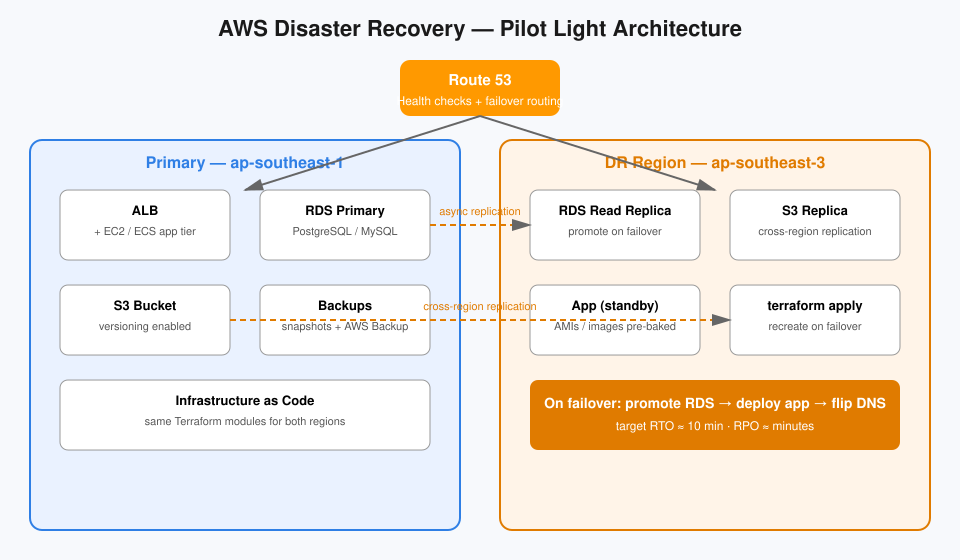

# AWS Disaster Recovery Guide


> Hope is not a strategy. Neither is a backup you never tested.

## TL;DR

Disaster Recovery (DR) on AWS is about two numbers and four strategies:

| | RTO (Recovery Time Objective) | RPO (Recovery Point Objective) |
|---|---|---|
| **Meaning** | How long can you be *down*? | How much data can you *lose*? |
| **Example** | RTO = 4 hours | RPO = 1 hour |

Pick the cheapest strategy that meets your RTO/RPO — not the fanciest one. This guide walks through the four AWS DR strategies, shows how they fail over with Route 53, and gives you runnable Terraform to replicate it.

## The four strategies (cheapest → most expensive)

| Strategy | RTO / RPO | What runs in the DR region | Best for |
|---|---|---|---|
| 1. **Backup & Restore** | Hours / Hours | Nothing — only backups | Non-critical workloads, dev environments |
| 2. **Pilot Light** | ~10 minutes / Minutes | Core DB replicated, app "idles" | Most production apps |
| 3. **Warm Standby** | Minutes / Seconds | Scaled-down live copy | Critical services |
| 4. **Multi-site Active/Active** | ~0 / ~0 | Full copy, serving traffic | Mission-critical, global |

> Rule of thumb: cost rises roughly 10x between each level. Start with Backup & Restore and only upgrade when the SLA demands it.

## Architecture



The diagram shows a **Pilot Light** setup — the sweet spot for most teams:

- **Primary region (ap-southeast-1):** full production — ALB, EC2/ECS app tier, RDS primary, S3 buckets.
- **DR region (ap-southeast-3):** RDS read replica (promotable), S3 cross-region replication, pre-baked AMIs / container images, infrastructure as code ready to `terraform apply`.
- **Route 53 health checks** watch the primary endpoint. On failure, DNS failover routes traffic to the DR region.

## Key building blocks

### 1. Cross-Region Replication for S3
Versioning + replication rules keep objects (and optionally deletes) mirrored to the DR bucket. Failover is just a bucket-swap.

### 2. RDS cross-region read replica / snapshot copy
A read replica in the DR region can be **promoted** to a standalone primary in minutes — this is the "pilot light" itself.

### 3. Route 53 failover routing
Health checks probe the primary endpoint every 30 seconds (10s with fast checks). When unhealthy, DNS answers point to the secondary record set.

### 4. Infrastructure as Code
Never hand-build the DR region. `terraform apply` from the same modules should recreate everything except the data.

## Code snippet

`dr.tf` provisions the replication backbone: S3 CRR, RDS read replica, and Route 53 failover records:

```hcl
# S3 cross-region replication (see dr.tf for full config)
resource "aws_s3_bucket_replication_configuration" "dr" {
  role   = aws_iam_role.replication.arn
  bucket = aws_s3_bucket.primary.id

  rule {
    id     = "to-dr-region"
    status = "Enabled"
    destination {
      bucket        = aws_s3_bucket.dr.arn
      storage_class = "STANDARD"
    }
  }
}

# RDS read replica in the DR region — promote it on failover
resource "aws_db_instance" "dr_replica" {
  provider                = aws.dr
  replicate_source_db     = aws_db_instance.primary.arn
  instance_class          = "db.t4g.medium"
  skip_final_snapshot     = true
}
```

Full, commented config in [`dr.tf`](./dr.tf).

## Try it yourself

1. `terraform init && terraform plan` — inspect what gets created.
2. Flip `enable_dr = true` to stand up the DR-region resources.
3. Simulate a failure: stop the primary app, watch the Route 53 health check flip, promote the RDS replica.
4. **Restore drill:** practice promoting the replica and pointing DNS — then document the actual RTO you achieved.

## Quiz teaser

RPO of 15 minutes + RTO of 30 minutes — which strategy? Warm standby, or is pilot light enough? [Take the 5-question quiz →](./quiz.md)

## Further reading

- [AWS Disaster Recovery whitepaper](https://docs.aws.amazon.com/whitepapers/latest/disaster-recovery-workloads-on-aws/disaster-recovery-options-in-the-cloud.html)
- [Route 53 health checks & DNS failover](https://docs.aws.amazon.com/route53/latest/dg/dns-failover.html)
- [S3 cross-region replication](https://docs.aws.amazon.com/AmazonS3/latest/userguide/replication.html)
